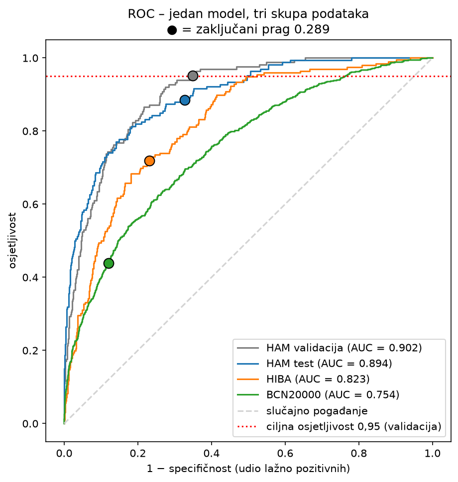

# Prepoznavanje melanoma na dermatoskopskim slikama primjenom prijenosnog učenja
### Evaluacija prenosivosti modela na vanjske skupove podataka

Završni projekt programa **„Stručnjak/inja za umjetnu inteligenciju”**, AI centar Lipik (2025./2026.).
Autor: Igor (liječnik, ambulanta opće medicine / HMP).

> ⚠️ **Edukacijski projekt.** Model nije namijenjen kliničkoj uporabi i ne zamjenjuje dermatologa ni patohistološku dijagnozu.

---

## 1. Problem i zašto

Binarna klasifikacija dermatoskopske slike: **je li lezija melanom (1) ili nije (0)**.

Klinički cilj je **ne propustiti melanom**. Zato je glavna metrika **osjetljivost (recall) za melanom**. Lažno pozitivan nalaz (nepotrebno upućivanje dermatologu) prihvatljiviji je od lažno negativnog (propušten melanom). Točnost se navodi samo informativno: melanoma je oko 11 %, pa bi model koji uvijek kaže „nije melanom” imao oko 89 % točnosti i ne bi pronašao nijedan melanom.

Projekt nije samo treniranje modela. Glavno pitanje je **što se događa kad isti model i isti prag primijenimo na podatke iz drugih ustanova**.

## 2. Podaci

Podaci **nisu u repozitoriju** (veličina i licence). Preuzimaju se s izvora:

| Skup | Uloga | Izvor | Licenca |
|---|---|---|---|
| **HAM10000** | trening / validacija / test | Tschandl i sur., *Scientific Data* 2018; [Harvard Dataverse, doi:10.7910/DVN/DBW86T](https://doi.org/10.7910/DVN/DBW86T); [Kaggle](https://www.kaggle.com/datasets/kmader/skin-cancer-mnist-ham10000) | CC BY-NC 4.0 |
| **HIBA Skin Lesions** | vanjska provjera 1 (Buenos Aires) | Hospital Italiano de Buenos Aires, ISIC Archive, [doi:10.34970/559884](https://doi.org/10.34970/559884) | CC BY |
| **BCN20000** | vanjska provjera 2 (Barcelona) – završni neovisni test | Hospital Clínic de Barcelona, [ISIC Archive](https://www.isic-archive.com) | CC BY-NC |

**Očekivana struktura mapa nakon preuzimanja:**
```
data/
  ham10000/  HAM10000_images_part_1/  HAM10000_images_part_2/  HAM10000_metadata.csv
  hiba/      images/  metadata.csv
  bcn20000/  ISIC-images/  bcn20000_metadata_<datum>.csv
```

**Glavne brojke (iz EDA-e):**
- **HAM10000:** 10 015 slika, 7 470 lezija; melanom 1 113 slika / 614 lezija (11,1 % slika), svi histopatološki potvrđeni; sve slike 600 × 450.
  Nevusi su samo u 37 % slučajeva histološki potvrđeni (ostalo praćenje / konsenzus).
- **HIBA:** 1 280 slika, 1 201 lezija, 589 pacijenata; melanom 196 slika (15,3 %); 181 različita veličina slike; tip kože po Fitzpatricku I–IV (tipova V–VI nema).
  Koriste se **samo dermatoskopske slike**, jer je model treniran na dermatoskopskim slikama HAM10000. Kliničke fotografije (obična kamera) bile bi drugi zadatak.
- **BCN20000:** isključeno 1 156 slika bez dijagnoze i 633 metastaze melanoma; jedna slika po leziji → 4 848 lezija, 695 melanoma (14,3 %); sve slike 1024 × 1024.

**Neovisnost skupova (provjereno):** nijedna slika (ISIC broj) nije zajednička HAM10000, HIBA i BCN20000, a nijedna lezija nije zajednička HIBA i BCN20000. *Ograničenje:* provjera se temelji na identifikatorima, pa ista fotografija objavljena pod drugim brojem ne bi bila otkrivena.

**Metapodaci (dob, spol, lokalizacija)** koriste se samo za opis podataka i analizu pogrešaka. **Model gleda samo sliku**, pa nedostajuće vrijednosti (npr. 57 slika bez dobi u HAM10000) nije trebalo nadopunjavati.

## 3. Pristup / model

1. **Podjela HAM10000 po leziji** (`podijeli_ham.py`): 70 / 15 / 15 % lezija (trening / validacija / test), stratificirano po melanomu, seed 42.
   Sve slike iste lezije u istom skupu, da model na testu ne „prepoznaje” lezije iz treninga (curenje podataka).
2. **Prijenosno učenje** (`train_melanom.py`): ResNet-18 s ImageNet težinama, novi zadnji sloj 512 → 2, uči se cijela mreža; Adam (lr = 1e-4), batch 32, 10 epoha, CPU (~5 min po epohi).
   - `CrossEntropyLoss` s **težinama klasa** izračunatima samo iz trening skupa (ostalo 0,56; melanom 4,46).
   - Augmentacija samo u treningu: `RandomResizedCrop`, horizontalno i vertikalno zrcaljenje, rotacija ±30°, blagi `ColorJitter`. **Bez `RandomGrayscale`**, jer je boja dijagnostički važna (ABCD pravilo).
   - Validacija / test: `Resize(256)` + `CenterCrop(224)` (čuva omjer stranica, tj. oblik lezije).
   - Sprema se epoha s **najboljim validacijskim AUC-om** (ne s najboljom točnošću).
   - Zastavica `PROBNI_RAD` služi za kratki probni pokretaj prije dugog treniranja. **Konačni model treniran je s `PROBNI_RAD = False`** (10 epoha, najbolja 6.).
3. **Prag odluke** (`evaluate_melanom.py`): biran **samo na validaciji**: najviši prag uz osjetljivost ≥ 95 %. Prag se zaključa (`prag.json`) i jednom primijeni na test, HIBA-u i BCN20000.
4. **Vanjske provjere** (`evaluate_hiba.py`, `evaluate_bcn.py`): isti model i isti prag, ništa se ne podešava.
5. **Analize u bilježnici:** lokalna prilagodba praga odluke na HIBA-i, analiza pogrešaka, Grad-CAM, dodatne analize (intervali pouzdanosti, razina lezije, kalibracija), demo.

### Zašto ovi izbori
| Odluka | Razlog |
|---|---|
| **ResNet-18 + prijenosno učenje** | Malo podataka (~7 000 trening slika): mreža koja je već naučila osnovne oblike na ImageNetu uči brže i bolje nego mreža od nule. ResNet-18 je dovoljno malen za treniranje na CPU-u. |
| **Podjela po leziji** | Lezije imaju više slika; da su dijeljene po slici, ista lezija bila bi i u treningu i u testu, pa bi rezultati bili nerealno dobri. |
| **Rotacija i zrcaljenje** | Dermatoskopska lezija nema „gore” ni „lijevo”: zakrenuta lezija je ista lezija. |
| **Bez grayscale, blagi ColorJitter** | Boja je dijagnostički znak (ABCD); blagi ColorJitter samo oponaša razlike između kamera. |
| **Težine klasa** | Melanoma je ~8× manje; bez težina model bi „naučio” da se isplati uvijek reći „ostalo”. Propušten melanom tako „boli” ~8× više. |
| **Prag na validaciji, cilj 95 %** | Propušten melanom klinički je skuplji od nepotrebnog upućivanja. Prag 0,5 nije prirodno pravilo, nego zadana vrijednost. Rezerva od 95 % uvedena je jer je u razvojnoj verziji prag na 90 % na testu dao 84 % (vidi `DNEVNIK_EKSPERIMENATA.md`). |
| **AUC za odabir epohe** | AUC ne ovisi o pragu i ne zavarava ga neravnoteža klasa kao točnost. |

### Hiperparametri
| postavka | vrijednost |
|---|---|
| mreža | ResNet-18, ImageNet težine, novi zadnji sloj 512 → 2, uči se cijela mreža |
| optimizator / stopa učenja | Adam, 1e-4 |
| batch / epohe | 32 / 10 (najbolja epoha 6 po val AUC-u) |
| gubitak | CrossEntropyLoss s težinama klasa 0,56 (ostalo) / 4,46 (melanom) |
| augmentacija (samo trening) | RandomResizedCrop(224, 0,7–1,0), H i V zrcaljenje, rotacija ±30°, ColorJitter 0,1 / 0,1 / 0,1 / 0,02 |
| validacija / test | Resize(256) + CenterCrop(224), ImageNet normalizacija |
| seed | 42 (podjela i trening) |
| uređaj / trajanje | CPU (AMD Ryzen AI 9 HX 370), ~5 min po epohi, ~50 min ukupno |

Odluke verzije 2 zapisane prije njezine evaluacije: `Plan_v2.md`. Tijek rada i što je kada viđeno: `DNEVNIK_EKSPERIMENATA.md`.

## 4. Rezultati

Model iz 6. epohe (val AUC 0,902). Zaključani prag = **0,289**. Postupak je **reproducibilan**: dva neovisna treniranja dala su identične rezultate.

### Jedan model, isti prag, tri skupa podataka

| | HAM10000 test | HIBA (Buenos Aires) | BCN20000 (Barcelona) |
|---|---|---|---|
| jedinica evaluacije | slika | slika | lezija (1 slika) |
| slika / lezija / melanoma | 1 504 / 1 121 / 166 | 1 280 / 1 201 / 196 | 4 848 / 4 848 / 695 |
| udio melanoma | 11,0 % | 15,3 % | 14,3 % |
| **AUC** | 0,894 | 0,823 | 0,754 |
| **osjetljivost (95 % CI)** | **0,886** (0,828–0,925) | **0,719** (0,653–0,778) | **0,439** (0,402–0,476) |
| specifičnost (95 % CI) | 0,673 (0,648–0,698) | 0,769 (0,743–0,793) | 0,879 (0,869–0,889) |
| preciznost / F1 | 0,252 / 0,392 | 0,361 / 0,480 | 0,378 / 0,406 |
| TP / FN / TN / FP | 147 / 19 / 901 / 437 | 141 / 55 / 834 / 250 | 305 / 390 / 3 652 / 501 |
| upućivanja po pronađenom melanomu | 4,0 | 2,8 | 2,6 |

95 % CI: Wilsonova metoda; intervali po slici ne uzimaju u obzir da slike iste lezije (i lezije istog pacijenta) nisu neovisne, pa su okvirni. Preciznost ovisi i o udjelu melanoma u skupu. Upućivanja po melanomu = (TP + FP) / TP. Tablica: `rezultati/objedinjena_tablica.csv`.



**Glavni nalaz:** dobar rezultat na testu iz istog izvora **ne jamči** jednak rad u drugoj ustanovi. Razlike u osjetljivosti su velike, ali ih treba tumačiti uz različit sastav skupova, različite jedinice evaluacije i ovisnost opažanja.

**Prag nije držao ni na izvornom izvoru:** osjetljivost je na validaciji 95,1 %, a na HAM testu 88,6 %. Prag je odabran na samo 164 melanoma, pa i sam ima slučajnu nesigurnost.

### Ostali rezultati
- **HAM10000 test, prag 0,5:** osjetljivost 0,837 (139/166), specifičnost 0,762. Odabrani prag pronalazi 8 melanoma više uz 119 lažnih uzbuna više.
- **Po leziji** (prosjek skora slika iste lezije, isti prag): HAM test AUC 0,926, osjetljivost 0,902 (83/92), specifičnost 0,750; HIBA AUC 0,816, osjetljivost 0,704 (112/159), specifičnost 0,777. Slijede isti obrazac kao rezultati po slici.
- **Lokalna prilagodba praga odluke na HIBA-i** (pacijenti podijeljeni na pola: polovica za odabir praga, polovica za provjeru): lokalni prag 0,067 umjesto 0,289 na provjernoj polovici vraća osjetljivost s 0,737 na **0,926**, ali specifičnost pada s 0,760 na 0,501. To je kompromis između propuštenih melanoma i lažnih uzbuna; rezultat je u skladu s pomakom domene, ali ga sam po sebi ne dokazuje, i ne zamjenjuje glavnu evaluaciju.
- **Tip kože (HIBA):** osjetljivost I–II 0,740 (125/169), III–IV 0,647 (11/17; 95 % CI 0,41–0,83, premalo za zaključak); tipova V–VI nema.
- **Skor pravih melanoma:** medijan HAM test 0,929, HIBA 0,650, BCN 0,227. Na BCN-u velik dio melanoma ima nizak skor. Snižavanje praga povećava osjetljivost (na BCN-u s 0,309 pri pragu 0,5 na 0,439 pri 0,289), ali uz više lažno pozitivnih nalaza; niži AUC pokazuje da problem nije samo u izboru praga. Mogući smjer poboljšanja je trening na podacima iz više ustanova.
- **Propušteni melanomi:** u opisnim tablicama nisu uočene velike razlike po spolu, a na BCN-u ni po regiji tijela (osjetljivost 0,42–0,46). Medijan dobi propuštenih je niži (pronađeni / propušteni: HAM 65 / 50, BCN 65 / 60), no na HAM-u je propuštenih samo 19, pa je to opis, a ne potvrđen nalaz.
- **Kalibracija:** model precjenjuje rizik. Težine klasa mogu tome pridonijeti, ali njihov udio nije zasebno ispitan. Zato se izlaz zove **skor modela**, a ne vjerojatnost (u tablicama stupac `p_melanom`), i odluka se donosi pragom.
- **Analiza pogrešaka:** model griješi sa sigurnošću (dio propuštenih melanoma ima skor ≈ 0). Velik dio lažnih uzbuna na HIBA-i su drugi karcinomi kože (BCC i SCC: 124 od 250).
- **Grad-CAM** (HAM, HIBA i BCN): kod pogođenih melanoma model uglavnom gleda leziju, a kod propuštenih često nigdje ne nalazi dokaz za melanom. U pregledanom uzorku ne koristi mjerilo, rub dermatoskopa ni dlake. Grad-CAM pokazuje *gdje* model gleda, ali ne dokazuje da prepoznaje medicinski relevantne znakove.

### Usporedni modeli (unaprijed zapisani u dnevniku, uspoređeni na validaciji)
| model | AUC validacija | AUC HAM test | AUC HIBA | AUC BCN |
|---|---|---|---|---|
| logistička regresija na histogramu boja | 0,777 | 0,722 | 0,660 | 0,602 |
| ResNet-18, zamrznut (uči se samo zadnji sloj) | 0,852 | 0,826 | 0,733 | 0,639 |
| **ResNet-18, cijela mreža – glavni model (seed 42)** | **0,902** | **0,894** | **0,823** | **0,754** |
| ResNet-18, cijela mreža – 3 seeda (srednja vrijednost ± SD) | 0,910 ± 0,007 | 0,903 ± 0,015 | 0,821 ± 0,003 | 0,722 ± 0,035 |

- Sama raspodjela boja daje znatno niži AUC, pa duboko učenje ima smisla. Uz svoj prag model na bojama na BCN-u označava gotovo sve slike (specifičnost 0,02), jer se boje snimaka razlikuju između ustanova.
- Fino podešavanje cijele mreže opravdano je na validaciji (0,902 prema 0,852).
- Glavni model je po validacijskom AUC-u najslabiji od tri seeda, dakle nije „sretno izabran”. Na BCN-u mu je AUC najviši od tri (raspon 0,685–0,754), pa je realnija procjena srednja vrijednost 0,722.
- **Prag je nestabilan između treninga:** isto pravilo dalo je pragove 0,289, 0,280 i 0,139, a osjetljivost na HAM testu 0,886, 0,855 i 0,946.
- **Jedinica evaluacije:** na BCN-u nasumična slika po leziji daje gotovo isto kao prva slika (osjetljivost 0,453 prema 0,439), a prosjek svih slika lezije nešto više (AUC 0,782, osjetljivost 0,472).
- **Više pragova:** na BCN-u ni prag 0,05 ne doseže 95 % osjetljivosti (0,773 uz specifičnost 0,578).
- **Brier score:** HAM test 0,152 (referenca bez modela 0,098), HIBA 0,136 (0,130), BCN 0,116 (0,123); skor nije dobra procjena vjerojatnosti, iako model dobro razlikuje klase.

Tablice: `rezultati/usporedba/`, `rezultati/tablica_pragova.csv`, `rezultati/tablica_protokola_lezija.csv`.

### Zaključak

Model dobro radi na podacima iz istog izvora, ali u drugim ustanovama znatno slabije prepoznaje melanom, a prag odabran na izvornom skupu ne prenosi se. Rezultati upućuju na to da je **raznolikost podataka važnija od same mreže**. Model bi se prije svake primjene morao lokalno provjeriti i prilagoditi, a za pouzdan rad trenirati na podacima iz više ustanova.

Grafovi i tablice: mapa `rezultati/` (EDA, evaluacija, HIBA, BCN, analiza pogrešaka, Grad-CAM, dodatne analize, demo).

## 5. Ograničenja

- Model je **binaran**: melanom nasuprot svemu ostalom. „Ostalo” uključuje i maligne promjene (BCC, SCC).
- Retrospektivni javni podaci; HAM10000 pretežno svijetla koža (Austrija, Australija); tipovi kože V–VI nisu zastupljeni ni u vanjskim skupovima, a III–IV ima samo 17 melanoma.
- Samo dermatoskopske slike; oznake nevusa u HAM10000 dijelom bez histološke potvrde.
- HAM10000 nema `patient_id`: podjela po leziji, ne po pacijentu.
- Prag je odabran na **jednom skupu** (HAM validacija, 164 melanoma) i ne prenosi se na druge ustanove.
- **HAM test i HIBA viđeni su u razvojnoj verziji 1**; potpuno netaknut je samo BCN20000 (vidi `DNEVNIK_EKSPERIMENATA.md`).
- Skor modela nije kalibrirana vjerojatnost.
- Intervali pouzdanosti po slici ne uzimaju u obzir ovisnost slika iste lezije ili pacijenta.
- Usporedni modeli i dodatni seedovi su naknadne analize (vidi `DNEVNIK_EKSPERIMENATA.md`).
- Model **nije validiran u stvarnom kliničkom radu** i ne zamjenjuje dermatologa ni patohistologiju.

**Što bi se moglo poboljšati:**
- trening na podacima iz više ustanova (npr. HAM + BCN + ISIC) i sa svim tipovima kože;
- lokalna provjera i prilagodba praga u svakoj ustanovi prije uporabe;
- kalibracija skora (npr. na lokalnim podacima), bootstrap intervali za AUC, unakrsna validacija;
- scheduler stope učenja, test-time augmentacija, novije arhitekture (EfficientNet, ConvNeXt) uz GPU;
- ablacija (doprinos augmentacije i težina klasa) i više od tri seeda;
- validacija u stvarnom kliničkom tijeku rada.

## 6. Upute za pokretanje

**Okruženje:** Python 3.12, CPU je dovoljan (Windows 11 testirano). Verzije paketa u `requirements.txt` očitane su iz okruženja u kojem je projekt izrađen.
```bash
conda create -n melanom python=3.12
conda activate melanom
pip install -r requirements.txt
```

**Demo bez treniranja** (spremljeni model je u repozitoriju, radi bez interneta): u bilježnici `melanom_v2.ipynb` pokrenuti **ćeliju 1**, zatim **ćeliju 11 (Demo)**. Potrebne su slike u `data/` i datoteke u `rezultati/`.

**Cijeli postupak od početka** (bilježnica vodi kroz sve korake):
1. Preuzmi podatke u mapu `data/` (vidi poglavlje 2).
2. `python podijeli_ham.py` – podjela po leziji, kopira slike u `data_split/`.
3. `python train_melanom.py` – treniranje (najprije s `PROBNI_RAD = True`, zatim `False`; ~50 min na CPU). Model: `runs/melanom_resnet18/best_model.pt`.
4. `python evaluate_melanom.py` – odabir praga na validaciji i jedna provjera na testu.
5. `python evaluate_hiba.py` i `python evaluate_bcn.py` – vanjske provjere (BCN treba popis iz bilježnice, ćelija 10b).
6. Bilježnica: lokalna prilagodba praga, analiza pogrešaka, Grad-CAM, dodatne analize (13b–13h) i demo.

Spremljeni model (`runs/melanom_resnet18/best_model.pt`, ~45 MB) uključen je u repozitorij, pa se evaluacija i demo mogu pokrenuti bez treniranja.

## 7. Struktura repozitorija

```
melanom_v2.ipynb          bilježnica: EDA, pokretanje skripti, analize, Grad-CAM, demo, zaključak
podijeli_ham.py           podjela HAM10000 po leziji
train_melanom.py          treniranje ResNet-18
evaluate_melanom.py       prag na validaciji + test
evaluate_hiba.py          vanjska provjera HIBA
evaluate_bcn.py           završni test BCN20000
train_usporedba.py        usporedni modeli (zamrznuta mreža, dodatni seedovi)
evaluate_usporedba.py     evaluacija usporednih modela istim pravilom
requirements.txt
Plan_v2.md                odluke zapisane prije evaluacije
DNEVNIK_EKSPERIMENATA.md  što je kada napravljeno i viđeno (v1 → v2 → dodatne analize)
runs/melanom_resnet18/    best_model.pt, TensorBoard zapisi
rezultati/                grafovi, tablice, predikcije, prag.json, podjela_ham.csv
```
